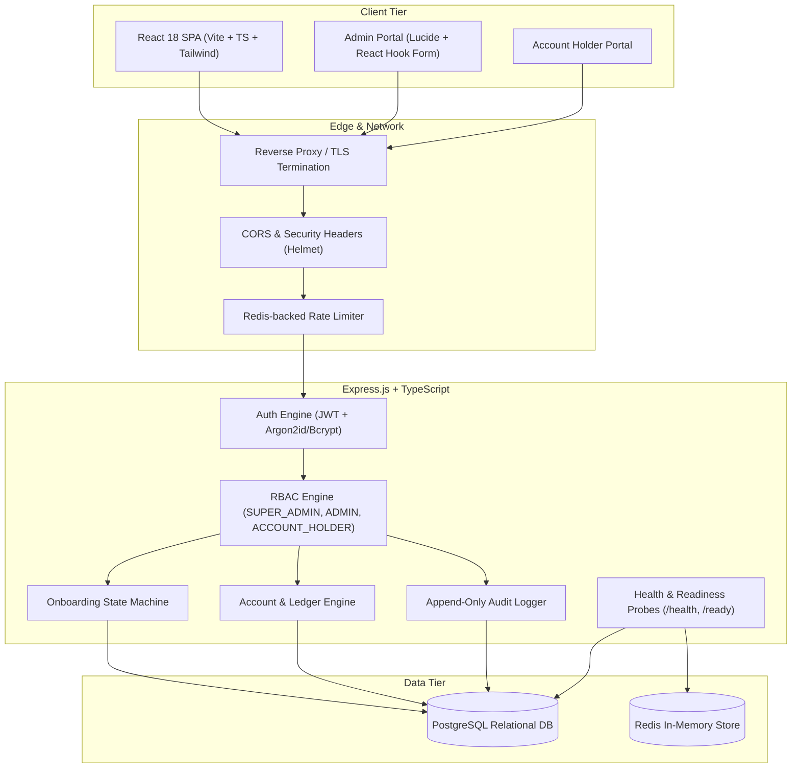
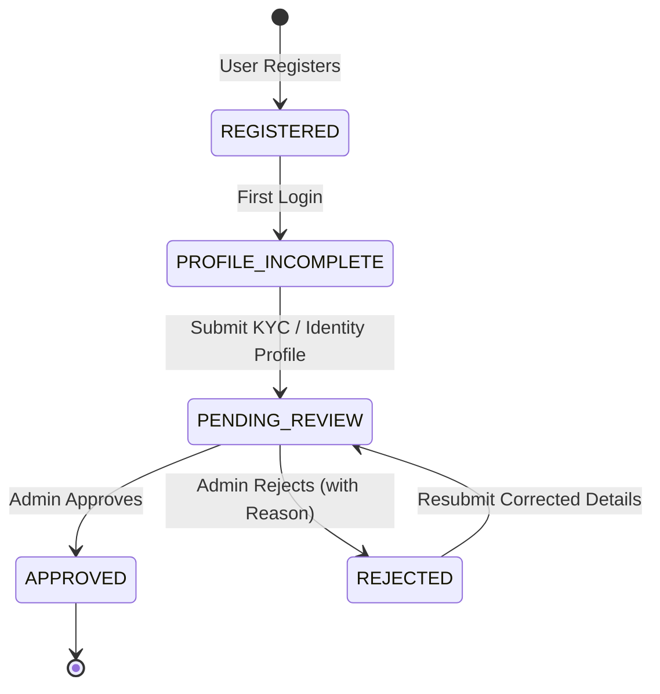

# Architecture Specification — BalanceVault

**Project**: BalanceVault — Money Movement with a Ledger You Can Prove  
**Challenge**: Snovasys Fresher Hiring Challenge 2026  
**Version**: 1.0.0  
**Status**: Approved Baseline  

---

## 1. System Overview

BalanceVault is a multi-tier, secure account management and financial ledger platform designed to guarantee integrity, tamper-resistance, and complete auditability across financial and administrative lifecycles.

---

## 2. Layered Architecture Principles

### 2.1 Frontend Architecture (`frontend/`)
- **Framework**: React 18 with TypeScript and Vite for near-instant builds.
- **Routing**: React Router v6 with strict layout hierarchy and `ProtectedRoute` guards checking JWT claims.
- **Form State & Validation**: React Hook Form coupled with Zod schema resolution for client-side instant feedback without trusting client validations.
- **Styling**: Tailwind CSS with custom design tokens for fintech reliability, clear visual hierarchy, WCAG contrast compliance, and responsive layouts.
- **State Management**: React Context (`AuthContext`) for session lifecycle, token refresh timers, and role metadata.

### 2.2 Backend Architecture (`backend/src/`)
The backend strictly follows a layered Controller-Service-Repository pattern:
- **Routes (`/routes`)**: URL mapping, HTTP verb handling, and parameter parsing.
- **Middlewares (`/middleware`)**: Cross-cutting concerns including correlation ID generation (`X-Correlation-ID`), JWT authentication, RBAC authorization guards, rate limiting, and global centralized error handling.
- **Controllers (`/controllers`)**: HTTP request unpacking, Zod schema validation execution, invoking services, and standardizing JSON responses `{ success, data, error, correlationId }`.
- **Services (`/services`)**: Pure business logic, state machine validation, invariant enforcement, atomic transactional coordination.
- **Repositories / ORM (`/repositories`, `prisma`)**: Data access layer via Prisma ORM enforcing relations, indexes, and transactions.
- **Audit Service (`/services/audit.service.ts`)**: Asynchronous, non-blocking but transactionally committed append-only audit trail logging.

### 2.3 Data & Storage Architecture
- **PostgreSQL**: System of record for accounts, profiles, identities, applications, and audit entries.
- **Redis**: Ephemeral cache and atomic counter store for IP/User rate limiting, token blocklisting, and rapid readiness probing.

---

## 3. Core Subsystems

### 3.1 Authentication & Session Subsystem
- **Password Security**: Argon2id or bcrypt (minimum 12 salt rounds) ensuring high work-factor resistance against offline hash cracking.
- **Token Format**: Standard RFC 7519 JSON Web Tokens (JWT) containing `sub` (userId), `role`, and `sessionId`.
- **Stateless Authorization**: JWT verified in-memory on every protected request; expired tokens rejected immediately (HTTP 401).

### 3.2 Role-Based Access Control (RBAC) Subsystem
- **Principle of Least Privilege**: Default deny on all non-public endpoints.
- **Roles**:
  - `SUPER_ADMIN`: System-level authority, administrator management, audit log inspection, configuration oversight.
  - `ADMIN`: Operational review, onboarding approval/rejection with mandatory justification, account status modifications.
  - `ACCOUNT_HOLDER`: Profile management, onboarding submission, personal account review. Strictly restricted from accessing administrative paths or other users' accounts (IDOR protection).

### 3.3 State Machine: Onboarding Lifecycle

### 3.4 Append-Only Audit Trail
- Every write or security-sensitive read event creates an immutable audit record:
  - `id`: UUIDv4
  - `actorId`: User ID or SYSTEM
  - `actorRole`: Role at time of execution
  - `action`: Specific standardized verb (e.g. `USER_REGISTERED`, `ADMIN_BOOTSTRAPPED`, `ONBOARDING_APPROVED`)
  - `targetEntity`: Entity type (e.g. `User`, `OnboardingApplication`, `Account`)
  - `targetId`: Target entity UUID
  - `metadata`: Sanitized JSON payload (passwords, tokens, and PII strictly redacted)
  - `ipAddress`: Request client IP (honoring trusted proxies)
  - `correlationId`: Distributed trace ID
  - `createdAt`: Database default `CURRENT_TIMESTAMP`

---

## 4. Operational & Observability Standards

- **Liveness Probe (`GET /health`)**: Returns `200 OK` if Node.js event loop and HTTP server are responsive.
- **Readiness Probe (`GET /ready`)**: Returns `200 OK` if PostgreSQL and Redis connections are live; returns `503 Service Unavailable` if either dependency is unhealthy.
