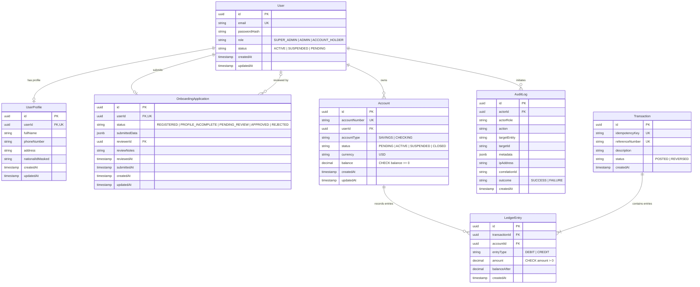

# Database Design & Privilege Model — BalanceVault

**Project**: BalanceVault — Money Movement with a Ledger You Can Prove  
**Challenge**: Snovasys Fresher Hiring Challenge 2026  
**Version**: 1.0.0  

---

## 1. Relational Entity-Relationship Diagram



---

## 2. Table Schemas and Constraints

### 2.1 User
- Primary Key: `id UUID DEFAULT gen_random_uuid()`
- Unique Indexes: `email CITEXT UNIQUE` (case-insensitive email)
- Check Constraints: `role IN ('SUPER_ADMIN', 'ADMIN', 'ACCOUNT_HOLDER')`, `status IN ('ACTIVE', 'SUSPENDED', 'PENDING')`

### 2.2 UserProfile
- Primary Key: `id UUID DEFAULT gen_random_uuid()`
- Foreign Key: `userId UUID UNIQUE REFERENCES "User"(id) ON DELETE CASCADE`
- Index: `CREATE INDEX idx_user_profile_phone ON "UserProfile"(phoneNumber);`

### 2.3 OnboardingApplication
- Primary Key: `id UUID DEFAULT gen_random_uuid()`
- Foreign Key: `userId UUID UNIQUE REFERENCES "User"(id) ON DELETE CASCADE`
- Foreign Key: `reviewerId UUID REFERENCES "User"(id) ON DELETE SET NULL`
- Check Constraints: `status IN ('REGISTERED', 'PROFILE_INCOMPLETE', 'PENDING_REVIEW', 'APPROVED', 'REJECTED')`

### 2.4 Account
- Primary Key: `id UUID DEFAULT gen_random_uuid()`
- Unique Constraint: `accountNumber VARCHAR(20) UNIQUE`
- Foreign Key: `userId UUID REFERENCES "User"(id) ON DELETE RESTRICT`
- Balance Floor Check Constraint: `CONSTRAINT chk_account_balance_positive CHECK (balance >= 0.00)`

### 2.5 AuditLog (Tamper-Resistant & Append-Only)
- Primary Key: `id UUID DEFAULT gen_random_uuid()`
- Immutable Design: No `updatedAt` column exists.
- Indexes:
  - `idx_audit_actor ON "AuditLog"(actorId, createdAt DESC)`
  - `idx_audit_action ON "AuditLog"(action, createdAt DESC)`
  - `idx_audit_target ON "AuditLog"(targetEntity, targetId)`
  - `idx_audit_correlation ON "AuditLog"(correlationId)`

---

## 3. PostgreSQL Multi-Role Security & Least Privilege

To satisfy **REQ-06 (Separate Database Roles)**, the database configuration separates operational responsibilities into distinct PostgreSQL roles:

```sql
-- Role 1: Migration Owner (DDL operations only during build/deploy)
CREATE ROLE bv_migration_owner WITH LOGIN PASSWORD 'CHANGE_IN_PRODUCTION';
ALTER SCHEMA public OWNER TO bv_migration_owner;

-- Role 2: Application Runtime Role (Standard backend operations)
CREATE ROLE bv_app_runtime WITH LOGIN PASSWORD 'CHANGE_IN_PRODUCTION';
GRANT CONNECT ON DATABASE balancevault TO bv_app_runtime;
GRANT USAGE ON SCHEMA public TO bv_app_runtime;

-- DML Permissions on operational tables
GRANT SELECT, INSERT, UPDATE ON "User", "UserProfile", "OnboardingApplication", "Account" TO bv_app_runtime;
-- Hardened: Runtime can ONLY INSERT and SELECT on AuditLog; NEVER UPDATE OR DELETE
GRANT SELECT, INSERT ON "AuditLog" TO bv_app_runtime;
REVOKE UPDATE, DELETE, TRUNCATE ON "AuditLog" FROM bv_app_runtime;

-- Hardened: If Ledger is activated, entries are strictly INSERT/SELECT
GRANT SELECT, INSERT ON "Transaction", "LedgerEntry" TO bv_app_runtime;
REVOKE UPDATE, DELETE, TRUNCATE ON "Transaction", "LedgerEntry" FROM bv_app_runtime;

-- Role 3: Read-Only Auditor / Analytics Role
CREATE ROLE bv_readonly_auditor WITH LOGIN PASSWORD 'CHANGE_IN_PRODUCTION';
GRANT CONNECT ON DATABASE balancevault TO bv_readonly_auditor;
GRANT USAGE ON SCHEMA public TO bv_readonly_auditor;
GRANT SELECT ON ALL TABLES IN SCHEMA public TO bv_readonly_auditor;
REVOKE INSERT, UPDATE, DELETE, TRUNCATE ON ALL TABLES IN SCHEMA public FROM bv_readonly_auditor;

-- Role 4: Bootstrap Operator (Specialized role for initial admin creation)
CREATE ROLE bv_bootstrap_operator WITH LOGIN PASSWORD 'CHANGE_IN_PRODUCTION';
GRANT CONNECT ON DATABASE balancevault TO bv_bootstrap_operator;
GRANT USAGE ON SCHEMA public TO bv_bootstrap_operator;
GRANT SELECT, INSERT ON "User", "AuditLog" TO bv_bootstrap_operator;
```

---

## 4. Migration Strategy
Prisma version-controlled migrations are placed under `backend/prisma/migrations/`.
- During local development: `npx prisma migrate dev --name <migration_name>`
- During CI/CD / Deployment: Executed via `bv_migration_owner` connection:
  `npx prisma migrate deploy`
