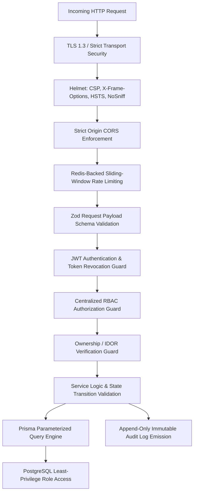

# Application Security Specification — BalanceVault

**Project**: BalanceVault — Money Movement with a Ledger You Can Prove  
**Challenge**: Snovasys Fresher Hiring Challenge 2026  
**Version**: 1.0.0  

---

## 1. Security Architecture & Threat Defense Model

BalanceVault enforces defense-in-depth across every layer of the application lifecycle.

---

## 2. Authentication Security Standards

1. **Password Storage**: Passwords are hashed using `Argon2id` or `bcrypt` with a minimum salt work factor of 12 rounds. Passwords are never logged, never returned in API payloads, and never persisted in plaintext.
2. **Password Policy**:
   - Minimum 8 characters.
   - At least 1 uppercase letter, 1 lowercase letter, 1 number, and 1 special character (`[!@#$%^&*]`).
   - Zod validation enforces this rule both client-side and server-side.
3. **Session Management (JWT)**:
   - Access tokens are cryptographically signed with HMAC-SHA256 (`HS256`) or RSA (`RS256`).
   - Standard payload contains `sub` (userId), `role`, and token unique identifier `jti`.
   - Token lifetime is strictly bounded (e.g. 15 minutes for access tokens).
4. **Credential Stuffing & Brute Force Prevention**:
   - Redis sliding window rate limiter throttles `POST /api/auth/login` to a maximum of 5 attempts per 60 seconds per IP/email tuple.
   - Generic authentication error messages (`"Invalid email or password"`) prevent user enumeration attacks.

---

## 3. Authorization & RBAC Standards

1. **Deny-by-Default**: Every API route requires explicit authentication and role checking unless marked as public.
2. **Strict Public Registration Guard**:
   - `POST /api/auth/register` explicitly forces the created role to `ACCOUNT_HOLDER`.
   - Any payload containing `role: 'ADMIN'` or `role: 'SUPER_ADMIN'` is ignored or rejected via strict Zod schemas that strip or disallow unexpected fields.
3. **Insecure Direct Object Reference (IDOR) Prevention**:
   - Account holders can only retrieve or operate on accounts where `account.userId === req.user.id`.
   - Administrative endpoints verify that the actor possesses `ADMIN` or `SUPER_ADMIN` privileges before allowing access to user records.
4. **Mass Assignment Protection**:
   - Request bodies are filtered through strict Zod schemas with `.strict()` parsing, discarding or erroring on unexpected fields such as `status`, `role`, or `balance`.

---

## 4. First-Administrator Bootstrap Security

The first-admin bootstrap provides a controlled, secure initialization mechanism without open registration:
1. **Pre-condition Validation**: Checks if any `SUPER_ADMIN` or `ADMIN` exists in the database. If any administrator exists, the procedure immediately aborts with HTTP 403 / Exit Code 1.
2. **One-Time Secret Token**: Requires a cryptographically high-entropy bootstrap secret (`BOOTSTRAP_SECRET` >= 32 bytes) configured in the environment.
3. **Atomic Execution**: Executed inside a serializable database transaction to prevent concurrent race-condition bootstrap exploits.
4. **Audit Immutability**: Emits an immediate `ADMIN_BOOTSTRAPPED` audit entry with the operator metadata and timestamp.
5. **Post-Bootstrap Deactivation**: The bootstrap CLI deletes or marks the bootstrap key as consumed.

---

## 5. Audit Trail & Data Security

1. **Tamper Resistance via PostgreSQL Privileges**:
   - The runtime application role (`bv_app_runtime`) has `GRANT INSERT, SELECT` on the `AuditLog` table, but `REVOKE UPDATE, DELETE, TRUNCATE`.
   - Even if an attacker gains application runtime code execution, historical audit logs cannot be modified or deleted via SQL commands.
2. **PII & Secret Redaction**:
   - The audit logger runs an automatic sanitizer that masks passwords, bearer tokens, card numbers, and raw government identifiers before JSON serialization.
3. **Correlation ID Tracking**:
   - An `X-Correlation-ID` header (or generated UUIDv4) is attached to every incoming request and logged in the audit record, providing complete distributed traceability across all system layers.

---

## 6. Redis Rate Limiting & Resilience Policy

1. **Rate Limit Tiers**:
   - Public Authentication (`/api/auth/login`, `/api/auth/register`): 5 requests / minute.
   - Onboarding Submissions (`/api/onboarding`): 10 requests / minute.
   - General Authenticated API: 100 requests / minute.
2. **Fail-Secure Architecture**:
   - If Redis becomes unreachable, the rate limiting middleware logs an alert. In production high-security mode, sensitive routes fail closed or fall back to an in-memory sliding window cache rather than allowing unthrottled traffic.
